<h1 align="center">Halftone</h1>

<p align="center">
  <a href="https://community.obsidian.md/themes/halftone"><picture><source media="(prefers-color-scheme: dark)" srcset="assets/get-it-on-obsidian-dark.svg">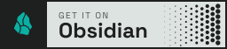</picture></a>
</p>

<p align="center">
  An Obsidian theme in the style of a retro desktop printed on paper:<br>
  black title bars, framed windows, pixel labels and a field of halftone dots.
</p>

<p align="center">
  
  
  
  
</p>

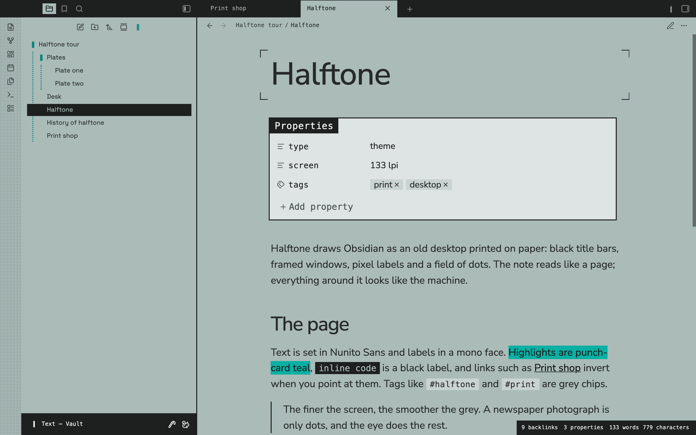

## Contents

- [At a glance](#at-a-glance)
- [Light and dark](#light-and-dark)
- [Colour presets](#colour-presets)
- [Custom colours](#custom-colours)
- [The page](#the-page)
- [Checkboxes](#checkboxes)
- [Everything is a window](#everything-is-a-window)
- [File explorer and fold markers](#file-explorer-and-fold-markers)
- [Dashboards](#dashboards)
- [Timelines](#timelines)
- [Paper and window colours](#paper-and-window-colours)
- [Joined windows, or a dotted desk](#joined-windows-or-a-dotted-desk)
- [Note width](#note-width)
- [New tab, modals and the small things](#new-tab-modals-and-the-small-things)
- [Phones and tablets](#phones-and-tablets)
- [Style Settings](#style-settings)
- [Note classes](#note-classes)
- [Customising with CSS variables](#customising-with-css-variables)
- [Palette](#palette)
- [Type](#type)
- [Installation](#installation)
- [Compatibility notes](#compatibility-notes)
- [Licence](#licence)

## At a glance

- **Every tab group is a window**: a frame, a black title bar and a paper body. Callouts, code blocks, tables, the properties block, menus and modals are windows too.
- **Seven colour presets**, each with a light and a dark palette: Halftone, Bondi, Cobalt, Grape, Acid, Tangerine and Newsprint.
- **Custom colours**: nine colour pickers, one set for each mode, change any part of any preset.
- **Real halftone**: the dots snap to whole screen pixels at every zoom level and screen density, so the grid stays even and never shimmers.
- **Square and flat**: no rounded corners and no shadows, anywhere.
- **No chevrons**: every chevron in Obsidian becomes a fold marker, a line by default or one of eight other shapes, which changes colour while what it opens is open.
- **Misprint checkboxes**: a ticked box is a block of colour printed off-register under its outline.
- **Dashboards and timelines** from plain Markdown, switched on per note with `cssclasses`.
- **Adjustable note width**: a slider for every note, and classes for single notes.
- **Self-contained**: the fonts are embedded and the theme makes no network requests.

## Light and dark

<table>
  <tr>
    <td width="50%"></td>
    <td width="50%">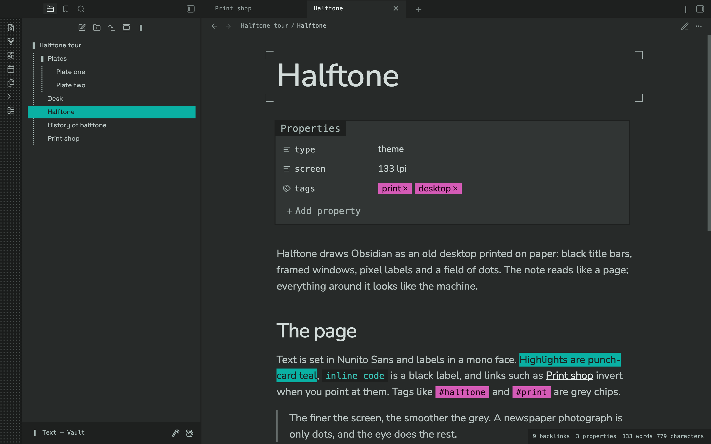</td>
  </tr>
  <tr>
    <td align="center"><sub>Light: sage paper, graphite ink, black title bars</sub></td>
    <td align="center"><sub>Dark: graphite paper, sage text, teal selection, magenta tags</sub></td>
  </tr>
</table>

Dark mode is not the light theme turned inside out. It has a palette of its own: graphite paper, near-black frames and title bars, sage text and line art, teal for selection and highlights, and magenta label chips for tags.

## Colour presets

<p align="center">
  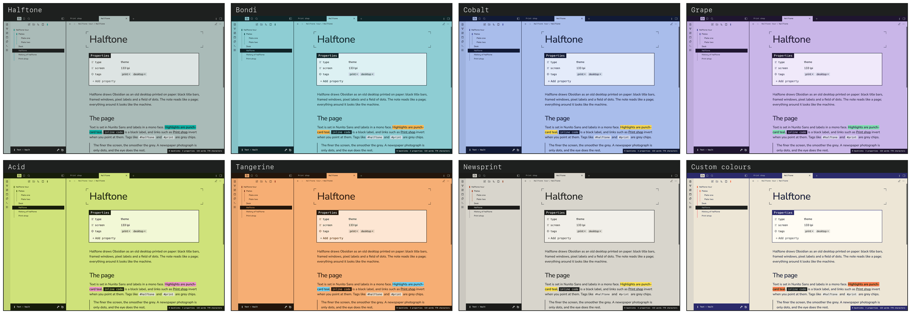
</p>

<p align="center">
  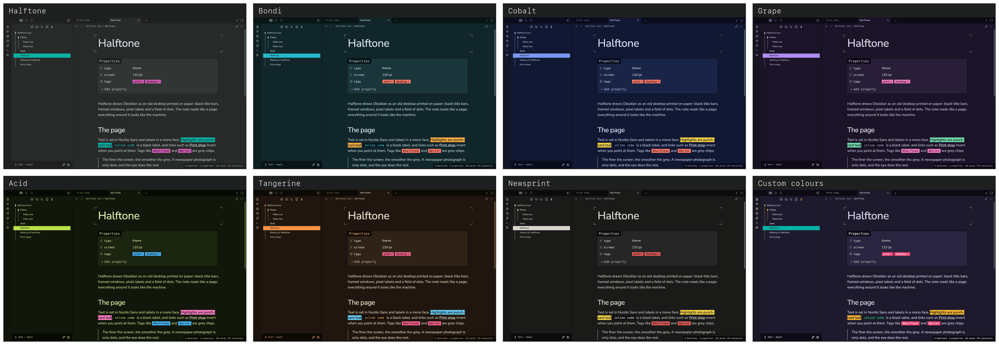
</p>

Pick a preset in **Style Settings → Halftone → Colour preset**. Each one repaints both modes and keeps the scheme: a desk printed with dots of its own ink, paper in the same colour, paler windows, ink-black title bars and frames, one colour for highlights and another for tags.

| Preset | Light mode | Dark mode |
| --- | --- | --- |
| Halftone | Sage paper, teal highlights, magenta tags | Graphite, teal selection and highlights |
| Bondi | Turquoise paper, tangerine highlights, coral tags | Deep teal, turquoise selection |
| Cobalt | Cornflower paper, yellow highlights, red tags | Navy, cornflower selection |
| Grape | Lilac paper, mint highlights, pink tags | Plum, lilac selection |
| Acid | Chartreuse paper, pink highlights, blue tags | Black-green, acid green selection |
| Tangerine | Orange paper, sky blue highlights, raspberry tags | Dark brown, orange selection |
| Newsprint | Grey paper, yellow highlighter, red tags | Charcoal, paper-grey selection |

Every text colour reads at 4.5:1 or more on what it sits on, the code colours included, and body text at 7:1 or more. The Paper and Window colour options belong to the Halftone preset, so they stand aside while another preset is on.

## Custom colours

<p align="center">
  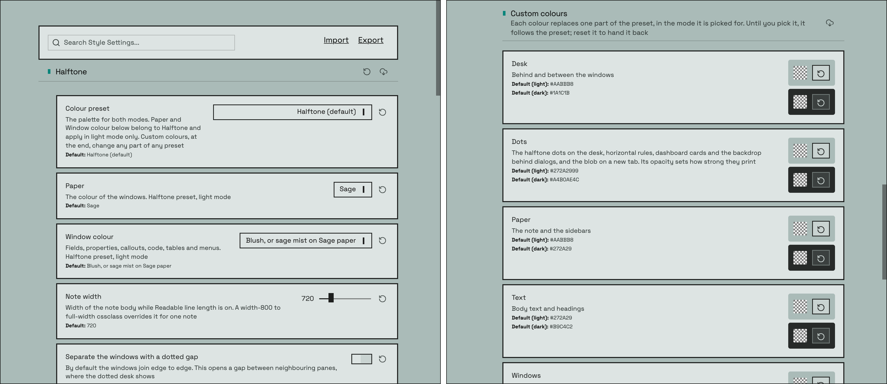
</p>

At the end of the Halftone settings, **Custom colours** has nine pickers, each with a light and a dark version:

| Colour | What it paints |
| --- | --- |
| Desk | Behind and between the windows |
| Dots | The halftone dots on the desk, dashboard cards and the backdrop behind dialogs, and the blob on a new tab |
| Paper | The note and the sidebars |
| Text | Body text and headings |
| Windows | Callouts, properties, code blocks, tables, fields and menus |
| Title bars and frames | Title bars, the status bar, table headers and the frames round every window |
| Highlight | Highlighted text and the text selection |
| Accent | Tags on hover (and at rest in dark mode), the line between panes on hover, and Misprint checkboxes |
| Guide lines | The line under an open folder and every lit fold marker |

- **A colour only takes effect once you pick it.** Until then that part follows the preset, and resetting a picker hands it back.
- **Custom colours work on top of any preset**, so you can start from the closest preset and change only what you want.
- **Text looks after itself**: on a picked title bar, highlight or tag, the text turns white or black, whichever reads. Ribbon icons do the same on a picked desk.
- **Shades are worked out for you**: pick a window colour and the chips, table borders and code insets take darker or lighter shades of it.

## The page

The note itself reads like a printed page, and everything around it looks like the machine.

- **The note title sits inside crop marks**, like a proof sheet. Style Settings can hide them or centre the title.
- **Headings**: H1 to H3 are set in the text face with tight tracking. H4 is a black label chip, H5 a mono column label with a rule on its left, and H6 a caption in capitals.
- **Highlights are punch-card teal**, or the preset's highlight colour. Links inside a highlight take the highlight's ink, so they stay readable in both modes.
- **Coloured highlights** (Obsidian's red, orange, yellow, green, blue and purple) are printed as solid inks of the same weight as the default, so each one stands out on every paper, and their text switches between black and white to stay readable.
- **Inline code is a black label**, and tags are chips that take the accent colour when you point at them.
- **Links invert when you point at them**, like a selected menu item. Links to notes that don't exist yet are muted, with a dashed underline, and invert the same way.
- **Links in a title bar** (a callout title, a table header) are drawn in the bar's own light ink, and invert against the bar.
- **Horizontal rules are a solid line** in the line-art colour, square at both ends, and blockquotes carry a solid rule in the same colour.

## Checkboxes

<p align="center">
  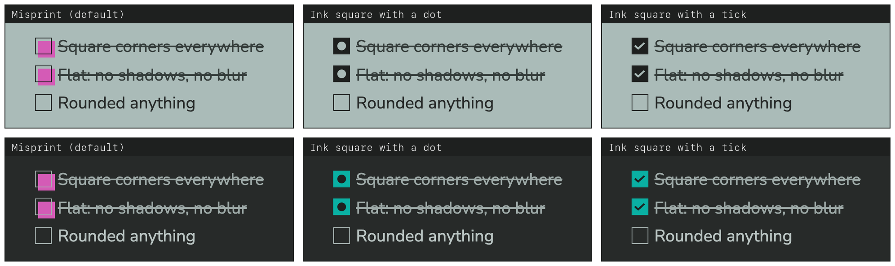
</p>

A ticked checkbox is a **Misprint**: a block of the accent colour printed slightly off-register under the box's outline, with no mark. The block follows the preset's accent colour, and the Accent picker if you set one.

**Style Settings → Halftone → Checkbox** offers two other styles: an ink square with a dot, and an ink square with a tick. The style applies to every checkbox: tasks, table cells, properties, callouts and Obsidian's own dialogs.

## Everything is a window

<table>
  <tr>
    <td width="50%">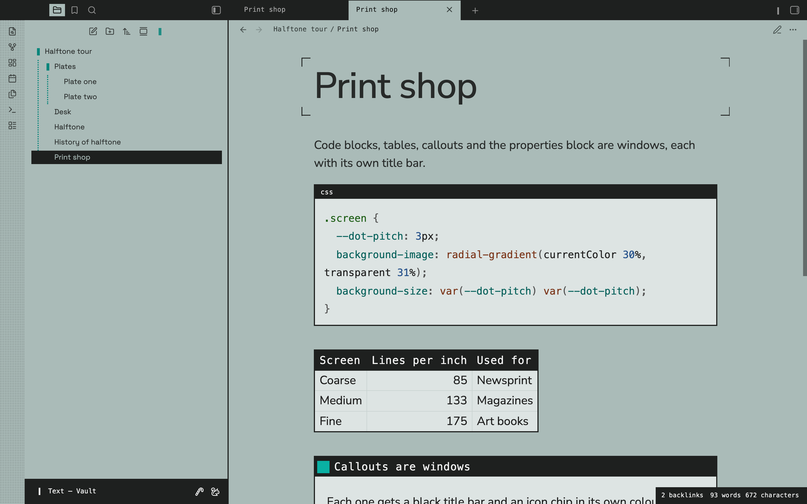</td>
    <td width="50%">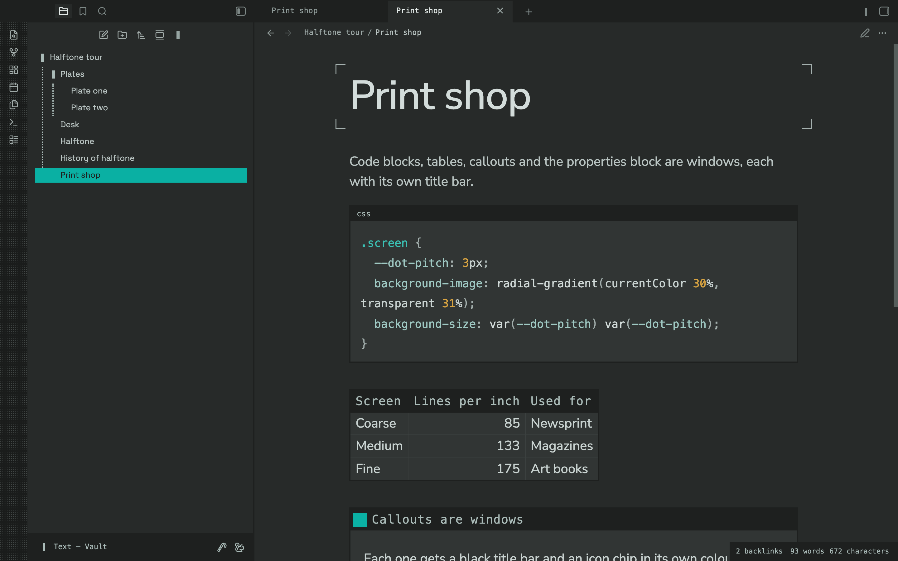</td>
  </tr>
</table>

- **Code blocks** get a title bar that names the language, with the copy button in the bar.
- **Tables** get a black header row and a frame.
- **Callouts** get a title bar and an icon chip in the callout's own colour. The icon turns black or white, whichever reads on that colour.
- **Properties** sit in a window titled *Properties*.
- **Menus, modals, the command palette and the switchers** are framed windows with title bars. Behind a modal, a halftone screen covers the workspace.

## File explorer and fold markers

<p align="center">
  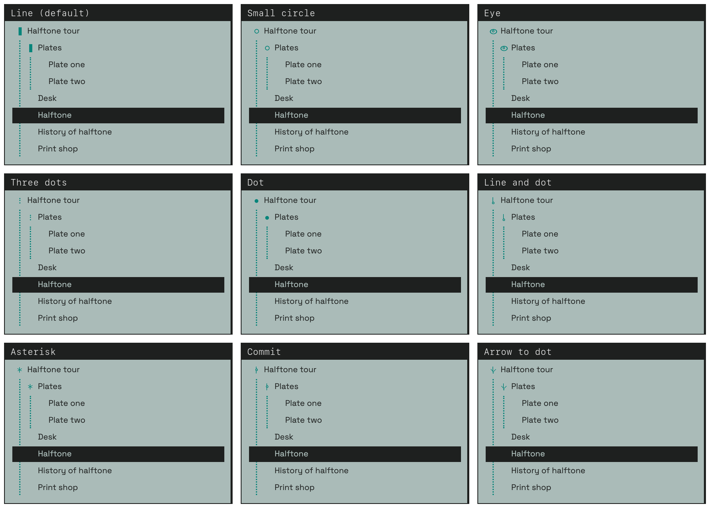
</p>

Every chevron in Obsidian becomes a **fold marker**. By default it is a short vertical line, which widens and lights up in the guide colour while what it opens is open. **Style Settings → Halftone → Fold marker** offers eight other shapes: a small circle, an eye that opens, three dots, a dot, a line and dot, an asterisk, a commit and an arrow to a dot.

The marker replaces every chevron:

- **Fold toggles** for headings, lists, callouts, the properties block, HTML `<details>`, and every tree (outline, bookmarks, tags, search and backlinks).
- **Menus and pickers**: the vault switcher, the tab list, submenus, navigable rows in Settings and the Bases views menu. The marker lights while you point at it or its menu is open.
- **Collapse all**: the explorer's button lights while anything is open, which is when it collapses everything.
- **Dropdowns** end in the marker instead of an arrow.

Open folders hang their contents from dotted guide lines: teal on sage paper, maroon on pink paper and sage in dark mode. Each preset has a guide colour of its own. Bookmarks, the outline and search results get the same dotted guides.

## Dashboards

<table>
  <tr>
    <td width="50%">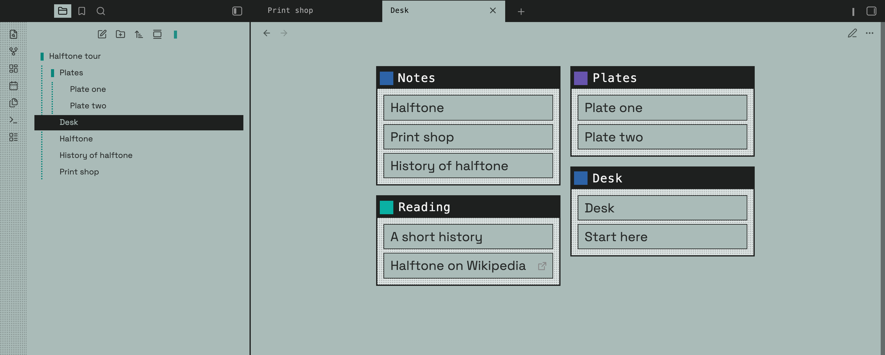</td>
    <td width="50%">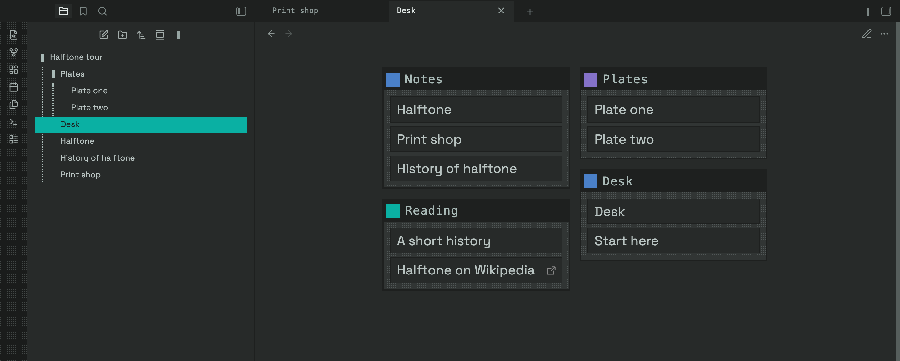</td>
  </tr>
</table>

Add `dashboard` to a note's `cssclasses` and, in reading view, its callouts become cards. Add `hide-all` as well to hide the note title and properties.

```markdown
---
cssclasses:
  - dashboard
  - hide-all
---

> [!note] Notes
> - [[Halftone]]
> - [[Print shop]]

> [!tip] Reading
> - [[A short history]]
> - [Halftone on Wikipedia](https://en.wikipedia.org/wiki/Halftone)
```

- **Cards pack into columns at their own height**, so no card is padded out with empty space. Each card keeps one width, 300px by default.
- **The columns are centred** and sized to whole cards. One or two cards sit in the middle instead of filling the first columns of a wide box.
- **Groups**: a heading or a line of text between cards starts a new group and spans the full width.
- **Links in a card become framed rows** that invert when you point at them.
- **With `hide-all`**, the view header floats over the cards and shows only its buttons.
- **Width**: a dashboard grows to 1400px, or to the width set by a [width class](#note-width) such as `width-1200`.
- **Live Preview** keeps the cards in one centred column, so they stay easy to edit.
- **A hand-written `<div class="dashboard-grid">`** lays out the callouts inside it as a plain grid.

## Timelines

<table>
  <tr>
    <td width="50%">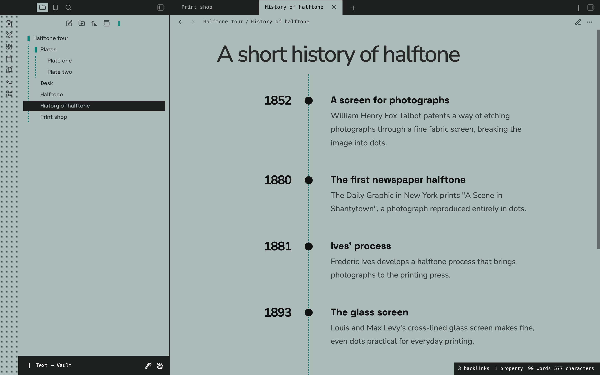</td>
    <td width="50%">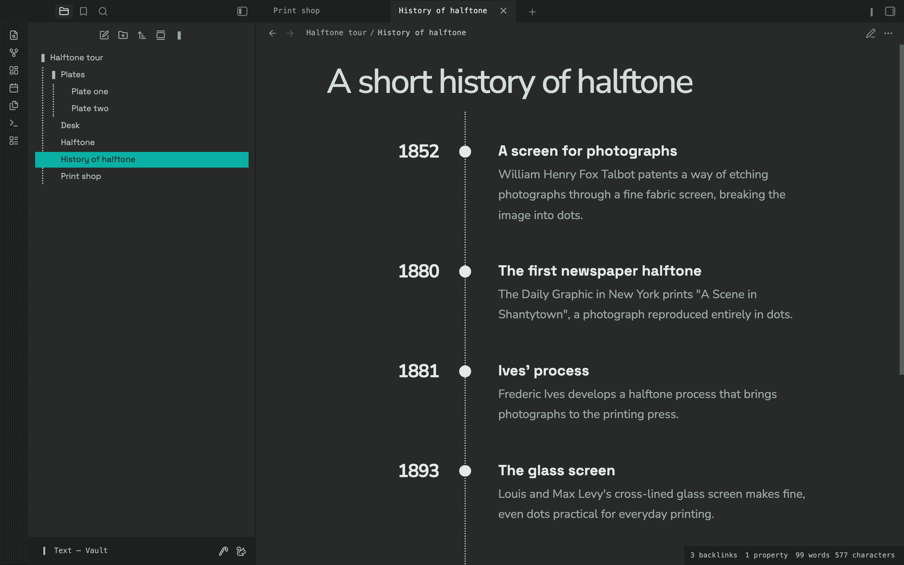</td>
  </tr>
</table>

Add `custom-timeline` to a note's `cssclasses` and, in reading view, a list becomes a timeline. Every three items make one entry: a date, a title and a line of text.

```markdown
---
cssclasses:
  - custom-timeline
---

- 1880
- The first newspaper halftone
- The Daily Graphic in New York prints "A Scene in Shantytown".
- 1893
- The glass screen
- Louis and Max Levy's cross-lined glass screen makes fine, even dots practical.
```

- **Dates sit to the left of a dotted spine**, drawn in the same colour as the file explorer's guide lines.
- **Each date has a dot.** Point at an entry and the entry tints while its dot grows and glows.
- **Titles and text slide in** when the note opens. If your system asks for reduced motion, they appear without moving.
- **On phones** the timeline becomes a single column, with the spine on the left.

## Paper and window colours

<p align="center">
  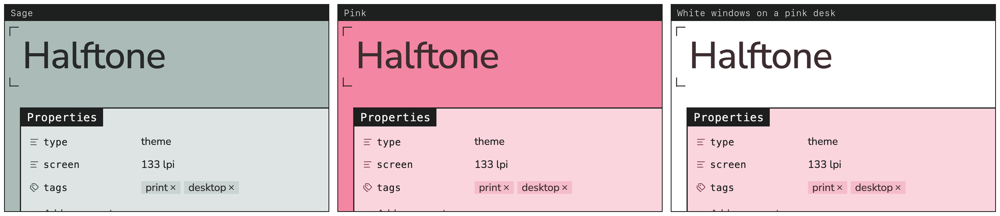
</p>

With the Halftone preset, light mode prints on **sage** paper by default. In Style Settings you can switch to **pink** paper, or to **white windows on a pink desk**.

The **window colour** covers fields, properties, callouts, code, tables and menus. It can be blush, sage mist, panel grey or white. Blush is the paper's own window colour: blush on pink and white paper, sage mist on sage.

## Joined windows, or a dotted desk

<p align="center">
  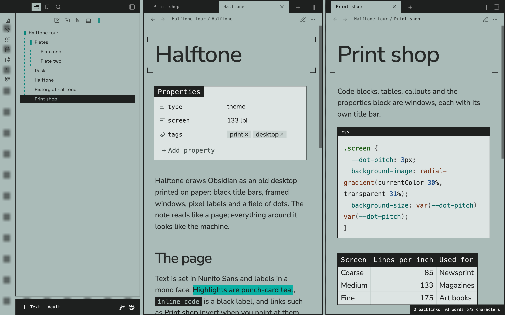
</p>

By default the windows join edge to edge. Turn on **Separate the windows with a dotted gap** in Style Settings and each tab group becomes a framed window standing on a dotted desk, which shows only in the gaps between windows.

## Note width

Style Settings has a **Note width** slider, from 500 to 1600px and 720px by default. It applies while Obsidian's *Readable line length* is on.

To set the width of one note, add a class to its `cssclasses`. A width class works even with *Readable line length* off, on screens at least 768px wide.

| Class | Note width |
| --- | --- |
| `width-800` | 800px |
| `width-900` | 900px |
| `width-1000` | 1000px |
| `width-1200` | 1200px |
| `width-1600` | 1600px |
| `full-width` | the whole pane |

## New tab, modals and the small things

<table>
  <tr>
    <td width="50%">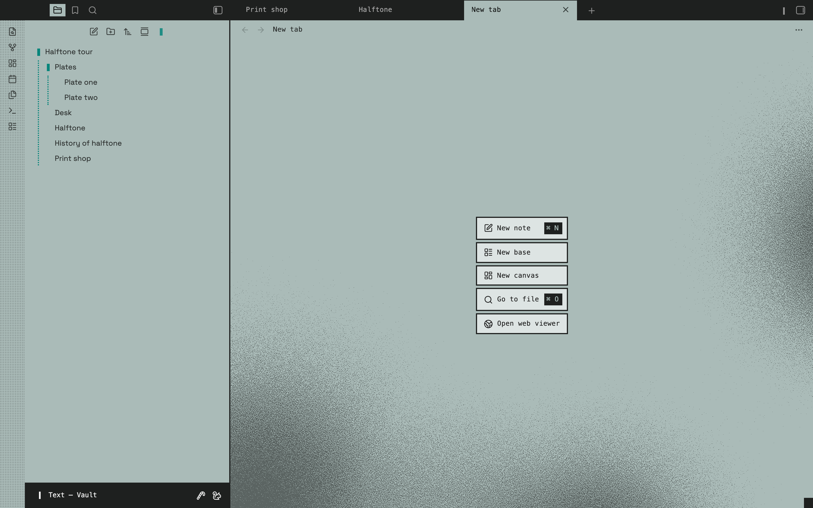</td>
    <td width="50%">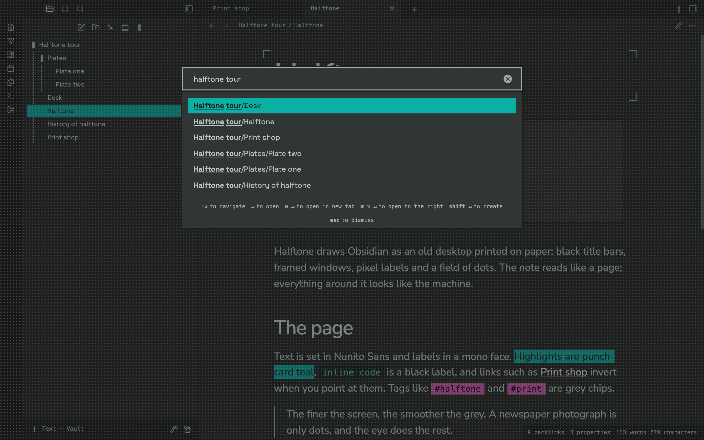</td>
  </tr>
  <tr>
    <td align="center"><sub>A new tab</sub></td>
    <td align="center"><sub>The quick switcher</sub></td>
  </tr>
</table>

- **New tab**: an empty tab shows a halftone cloud behind framed buttons, printed in the desk's dot colour.
- **Selection**: the selected row in menus, lists and switchers inverts: black on light paper, and the preset's selection colour in dark mode.
- **Scrollbars** are square and thin, and show only while the pointer is over the window. On macOS the theme draws them in place of the system's rounded ones.
- **Chrome**: the status bar is a small window in the corner, and the vault profile is a small window at the foot of the left sidebar, level with the main window's bottom edge.
- **No shadows**: menus, modals, pop-ups, notices and cards are flat, framed windows.

## Phones and tablets

<p align="center">
  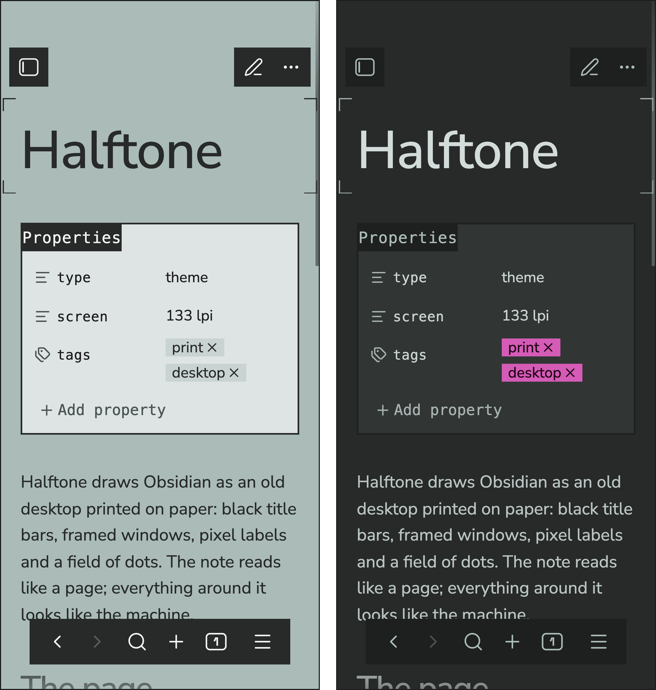
</p>

- **Phones** get one full-bleed window, and the desk never shows.
- **Controls** are touch-sized and still square. The bottom bar, the floating header buttons and the toolbar above the keyboard are black chips.
- **Softer black**: with the Halftone preset, bars, frames and inverted rows use graphite on phones and tablets, because near-black reads as pure black on a small bright screen. The other presets keep their own tinted ink.
- **Menus** open as sheets, and drawers have a frame on their open edge.
- **Tablets** keep the windows.

## Style Settings

Halftone works without any plugin. With [Style Settings](https://github.com/mgmeyers/obsidian-style-settings) installed, these options appear under *Halftone*:

| Setting | Options | Default |
| --- | --- | --- |
| Colour preset | Halftone, Bondi, Cobalt, Grape, Acid, Tangerine, Newsprint | Halftone |
| Paper | Sage, Pink, White windows on a pink desk (Halftone preset, light mode) | Sage |
| Window colour | Blush, Sage mist, Panel grey, White (Halftone preset, light mode) | Blush |
| Note width | 500 to 1600px | 720px |
| Separate the windows with a dotted gap | on or off | off |
| Turn off the halftone dots | on or off | off |
| Hide the crop marks around the note title | on or off | off |
| Centre the note title | on or off | off |
| Headings in Space Grotesk | on or off | off |
| Pixel font in the file explorer | on or off | off |
| Fold marker | Line, Small circle, Eye (shut while folded), Three vertical dots, Dot, Line dot bottom vertical, Asterisk, Git commit vertical, Arrow down to dot | Line |
| Checkbox | Misprint, Ink square with a dot, Ink square with a tick | Misprint |
| Custom colours | Desk, Dots, Paper, Text, Windows, Title bars and frames, Highlight, Accent, Guide lines, each for light and dark mode | the preset's colours |

## Note classes

Add any of these to a note's `cssclasses` property.

| Class | What it does |
| --- | --- |
| `dashboard` | Reading view lays the note's callouts out as packed cards. See [Dashboards](#dashboards). |
| `custom-timeline` | Reading view turns a list into a timeline. See [Timelines](#timelines). |
| `hide-all` | Hides the note title and properties. |
| `width-800` to `width-1600`, `full-width` | Sets the width of that note. See [Note width](#note-width). |

## Customising with CSS variables

The [custom colours](#custom-colours) in Style Settings cover the main colours. For anything else, every colour and size is a variable, so a short [CSS snippet](https://help.obsidian.md/snippets) is enough to change one. Use `html body.theme-light` and `html body.theme-dark` as the selector, so the snippet outranks the theme:

```css
html body.theme-light,
html body.theme-dark {
  --hf-guide-color: #2D63A7;      /* file-tree guide lines, lit markers and the timeline spine */
  --hf-blob-opacity: 0.35;        /* strength of the halftone on a new tab */
  --hf-dashboard-col-width: 260px;
}
```

| Variable | Controls | Default |
| --- | --- | --- |
| `--hf-guide-color` | File-tree guide lines, lit fold markers and the timeline spine | the preset's guide colour: teal `#08857B` on sage paper, maroon on pink paper, sage in dark mode |
| `--hf-guide-width`, `--hf-guide-style` | How the guide lines are drawn | `2px`, `dotted` |
| `--hf-marker-size` | The fold markers | `13px` |
| `--hf-line-width`, `--hf-line-width-open` | The line marker, at rest and open | `3px`, `5px` |
| `--hf-dot-size` | The dot marker | `6px` |
| `--hf-dot-color` | Fold markers at rest | the colour of the text around them |
| `--hf-dot-glow-color` | Lit markers on black bars and inverted rows, and the glow on a timeline dot | pink on sage paper, maroon on pink paper, the guide colour in dark mode |
| `--hf-blob-opacity` | The halftone on a new tab, from `0` to `1` | `0.6` |
| `--hf-scrollbar-size` | Scrollbar thickness | `8px` |
| `--hf-note-width` | Note width with *Readable line length* on | `720px` |
| `--hf-dashboard-col-width` | Dashboard card width | `300px` |
| `--hf-dashboard-gap` | Space between dashboard cards | `16px` |
| `--hf-dashboard-max-width` | Widest a dashboard grows without a width class | `1400px` |
| `--hf-tl-date-width` | Width of the timeline's date column | `200px` |
| `--hf-tl-row-gap` | Space between timeline entries | `2.5rem` |
| `--hf-tl-max-width` | Width of a timeline note | `800px` |
| `--hf-tl-dot-size`, `--hf-tl-dot-color` | The dot on each date | `0.9rem`, the strong text colour |
| `--hf-tl-spine-color` | The timeline's spine | the guide colour |
| `--hf-gap` | Gap between windows when separated | `8px` |
| `--hf-frame` | Thickness of every window frame | `2px` |
| `--hf-crop-length`, `--hf-crop-weight` | The crop marks around the note title | `16px`, `1.5px` |

## Palette

The Halftone preset:

| Role | Sage paper | Pink paper | Dark |
| --- | --- | --- | --- |
| Paper | `#AABBB8` | `#F386A2` | `#272A29` |
| Desk between windows | `#AABBB8` | `#F386A2` | `#1A1C1B` |
| Text | `#272A29` | `#3D2D30` | `#B9C4C2` |
| Headings | `#272A29` | `#3D2D30` | `#D3DCDA` |
| Title bars and frames | `#1E201F` | `#1E1E1E` | `#1E201F` |
| Line art: rules, checkbox outlines, crop marks | `#1E201F` | `#1E1E1E` | `#A4B0AE` |
| Halftone dots | `#272A29` at 60% | `#6F182C` at 75% | `#A4B0AE` at 30% |
| Window bodies | `#DDE4E3` sage mist | `#FBD5DE` blush | `#313534` |
| Highlights | `#0AB0A3` | `#0AB0A3` | `#0AB0A3` |
| Tag chips | `#C9D3D1`, `#D45BB6` on hover | `#F5BCCB`, `#D45BB6` on hover | `#D45BB6` with `#1E0013` text |
| Misprint checkboxes | `#D45BB6` | `#D45BB6` | `#D45BB6` |
| Selection and the active file | black, sage text | black, pink text | `#0AB0A3`, graphite text |
| Guide lines and lit markers | `#08857B` | `#6F182C` | `#AABBB8` |
| Lit markers on black bars | `#F386A2` | `#6F182C` | `#AABBB8` |

The other presets:

| Preset | Light paper | Highlight | Accent | Dark paper | Dark selection |
| --- | --- | --- | --- | --- | --- |
| Bondi | `#8ECDD3` | `#FFB648` | `#FF7B5C` | `#11262A` | `#27B8C8` |
| Cobalt | `#A9BDEB` | `#FFD84A` | `#FF6B5B` | `#111833` | `#7896F2` |
| Grape | `#C9B6E8` | `#7EE0B0` | `#FF7FC8` | `#1B1428` | `#B08CF2` |
| Acid | `#CFE27A` | `#FF85C0` | `#3FA9F5` | `#11170A` | `#B9E04A` |
| Tangerine | `#F6AE74` | `#6CD0F5` | `#E8457A` | `#20160F` | `#F59145` |
| Newsprint | `#D8D5CC` | `#F8E04E` | `#E04848` | `#1A1A19` | `#D8D5CC` |

Callout labels in light mode use `#308F26` green, `#2D63A7` blue, `#904226` orange, `#9D2645` red, `#C08726` yellow and `#6754AD` purple. Dark mode lifts each of them for contrast.

## Type

- **Text and headings**: Nunito Sans, with headings set tight. Style Settings can switch the note title and headings to Space Grotesk.
- **Interface**: Space Grotesk.
- **Labels, tabs, title bars and the status bar**: a mono face, SF Mono on macOS with fallbacks elsewhere, normalised with `font-size-adjust` so it sits at the same height as the text.
- **Code**: SF Mono, then your system's monospace font.

Space Grotesk and Nunito Sans are embedded in the theme, so text and interface look the same on every machine and the theme makes no network requests.

## Installation

1. Download [`theme.css`](theme.css) and [`manifest.json`](manifest.json) from this repository.
2. In your vault, create the folder `.obsidian/themes/Halftone` and put both files in it.
3. In Obsidian, open **Settings → Appearance → Themes** and choose **Halftone**.

Optionally, install [Style Settings](https://github.com/mgmeyers/obsidian-style-settings) to reach the options above.

## Compatibility notes

- **Requirements**: Halftone needs Obsidian 1.13 or later.
- **macOS menus**: right-click menus are native by default, so the system draws them. Turn off *Native menus* in **Settings → Appearance** to see the theme's menus.
- **Settings window**: Settings opens in its own window from Obsidian 1.13. That window already has a title bar, so the theme leaves its own out there.
- **Reading view only**: dashboards and timelines are laid out in reading view. Live Preview shows dashboards as one column of cards and timelines as a plain list.

## Licence

Halftone is released under the [MIT licence](LICENSE).

Space Grotesk and Nunito Sans are embedded under the SIL Open Font License 1.1.
